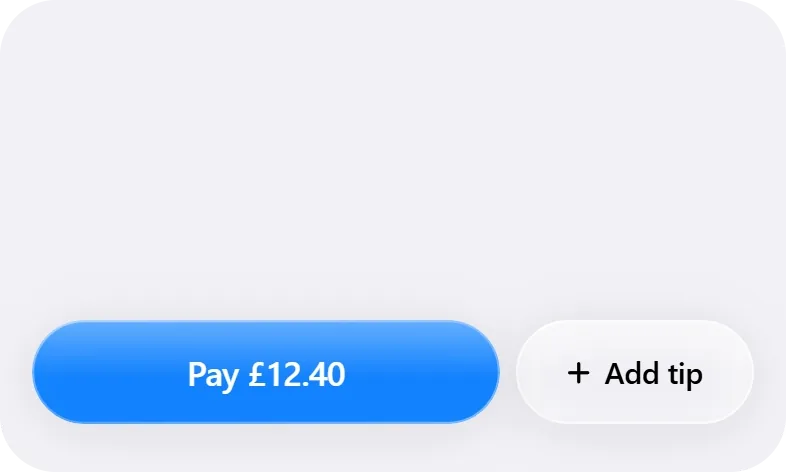
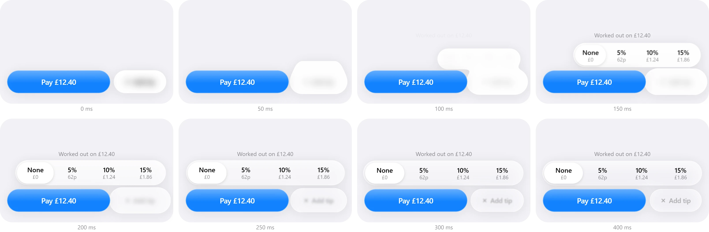
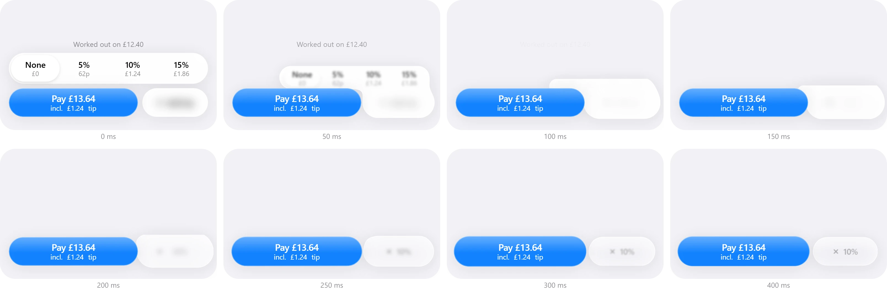

<p align="center">
  
</p>

# Liquid Glass Tip

A Pay button with Add tip beside it, made of liquid glass. Tap Add tip and the picker grows out of the button. Pick a tip and it folds back in.

**Try it live at [feralui.dev/library/liquid-tip](https://feralui.dev/library/liquid-tip).**

- **One piece of glass.** The button and the picker are a single shape. While the picker grows, a neck of glass joins the two, then thins and lets go.
- **Springs, not curves.** Every move is a spring set by response and bounce, the way iOS does it, so a tap mid-move carries on from where the glass is, with no jump.
- **Labels blur, they never slide.** The old label blurs out as the new one sharpens in the same spot.
- **The total stays honest.** Pay always shows what you will pay, and screen readers hear the new total.
- **Respects your settings.** Reduced motion lands every change at once. Reduced transparency makes the glass solid. Increased contrast darkens the text and the blue.

## Quick start

Needs Node 20.19+ or 22.12+.

```bash
git clone https://github.com/mortspace/liquid-glass-tip
cd liquid-glass-tip
npm install
npm run dev
```

Open http://localhost:5173 and tap Add tip.

## Use it in your app

Liquid Glass Tip is one folder with one dependency. Copy `src` into your project, say as `liquid-glass-tip`, then install it:

```bash
npm install web-haptics
```

```tsx
import { Tip } from './liquid-glass-tip'

export function Checkout() {
  return <Tip subtotal={24.8} onPay={({ total, tip }) => charge(total, tip)} />
}
```

It's built and tested on React 19. The panel is 393 by 236, the width of an iPhone screen. On a narrower screen, scale it down with a CSS transform, the way the demo does. In Next.js, render it from a client component.

## Props

| Prop            | Default             | What it does                                                                        |
| --------------- | ------------------- | ----------------------------------------------------------------------------------- |
| `subtotal`      | `12.4`              | The bill before the tip.                                                            |
| `tips`          | `[0.05, 0.1, 0.15]` | The tip choices as fractions. None is always first.                                 |
| `serviceCharge` | `0`                 | A service charge as a fraction, such as `0.125`. When it is set, tipping turns off. |
| `currency`      | `'GBP'`             | Any currency code. With pounds, the picker shows tips under £1 in pence.            |
| `locale`        | `'en-GB'`           | How amounts are written.                                                            |
| `onPay`         |                     | Called when Pay is tapped, with `{ subtotal, tip, service, total }`.                |
| `className`     |                     | Added to the root element.                                                          |

The colours are CSS variables on `.tip`, such as `--tip-bg`, `--tip-pay` and `--tip-glass-tint`.

## How I made it

I didn't tune this by feel. I recorded it and fixed what I saw in slow motion, one frame at a time.

### 1. Record it

I recorded Apple's own glass buttons on iOS 26 at 60 fps (Mail's Edit button turning into a check, and the Messages menu). Then I recorded mine at the same frame rate and put them side by side.

### 2. Go through it in slow motion

Played frame by frame, the iOS button does four things in order:

1. On touch the label dims. Nothing else moves.
2. On release the glass turns milky white in a single frame and swells by about 25%.
3. The milky shape changes into the new shape.
4. The new content arrives last, blurred and a little too big, and sharpens as the glass clears.

At full speed this just looks smooth. In slow motion it's a recipe, and my first version skipped step 2 completely.

### 3. Fix the first state

The open is the first thing anyone sees. Mine reached 95% of its size at 250 ms with almost no overshoot. iOS gets there in about 150 ms and overshoots by 2 to 3%. Mine felt slow and flat next to it.

So I retuned the springs until the frames lined up. The picker now starts as a thin sliver hidden inside the button. It rises in the button's own column first and widens 60 ms later, so it never crosses Pay. It reaches 95% of its height at 150 ms with 1.5% overshoot.

<p align="center">
  
</p>

### 4. Fix the end state

The close had two bugs I could not see at full speed.

- **Ears.** The hidden sliver sat 6 px above the button. When the button swelled on the way out, the sliver's corners poked out as two little shoulders for a few frames. It now sits fully inside the button.
- **A double step.** The old label sharpened again as the milk cleared, then swapped to the new one. Now the new label is set at the very start of the close, while the glass is still milky, so it only resolves once.

I also hold Pay's pulse for 200 ms, so the shape lands before anything else moves.

<p align="center">
  
</p>

### 5. Perfect it

Once it looked right, I measured it. On every frame I logged the glass outline's size and how many pieces it had, so a pop showed up as a number instead of a feeling. These are the fixes that took the worst frame from 75 ms to 29 ms:

- **No garbage per frame.** The buffers are made once and reused. New arrays on every frame caused 30 to 40 ms pauses.
- **No lens while moving.** The lens bend is an SVG filter the browser runs on the CPU, so it switches off during a move and comes back when the glass settles.
- **One mask that updates in place.** The outline lives in an inline SVG mask, and each frame only changes its path. It used to be a new mask image every frame.
- **A cheaper shadow.** The shadow is a CSS blur on its own layer instead of an SVG filter.
- **Skip what didn't change.** If the shape is the same as last frame, nothing is redrawn.

One bug wasn't about speed at all. Chromium clips the blur behind an element only to the box of its `clip-path`, so over a busy background the blur leaked out as a rectangle around the shape. That's why the glass is cut with a mask, which follows the real outline.

## How it works

- **The shape.** Each part is a rounded rectangle. Every frame their distance fields are joined with a smooth minimum, so two parts close together grow a neck between them. The outline is traced from that field with marching squares and smoothed.
- **The glass.** A `backdrop-filter` blurs what is behind the shape, masked to the outline. At rest a displacement map bends the edge like a lens. The milk is the same glass mixed toward white.
- **The motion.** One spring per value: rise, widen, press, swell, milk and pulse. One loop writes the styles straight to the page, so React only renders when the state changes.

## Project layout

```
src/
  Tip.tsx                the component: state, open, pick and close
  bill.ts                tip choices, totals and money formatting
  layout.ts              where each piece of glass sits
  timing.ts              the springs and delays
  tip.css                every style, scoped under .tip
  glass/
    Glass.tsx            one sheet of glass
    field.ts             the distance field and the smooth union
    contour.ts           tracing the outline
    lensMap.ts           the lens bend
    render.ts            field to outline and lens
    geometry.ts          rounded rectangles and bounds
  motion/
    spring.ts            the spring
    useSprings.ts        the frame loop
    math.ts              lerp and clamp
  text/
    Swap.tsx             the blur swap for labels
    PlusX.tsx            plus that turns into a cross
  icons/                 the plus and the check
  platform/              haptics and reduced motion
  index.ts               the public exports
demo/                    the page that npm run dev serves
```

## Browsers

I tested it in Chrome, and in WebKit and Firefox through Playwright. The lens bend is an SVG filter inside `backdrop-filter`, which Chromium draws in full. Other browsers may draw the glass without the bend.

Keep the panel out of anything that clips with rounded corners (`overflow: hidden` with `border-radius`). Chrome then stops masking the blur to the outline and the glass shows as a rectangle.

## Fonts

I designed it in Apple's SF Pro, but SF Pro isn't licensed for use outside Apple's platforms, so this repo ships no font files. On Apple devices the system font is SF Pro already. Everywhere else the text is replaced with Inter, if it is installed, or your system font, so it will look a little different from the recording.

To use your own font, set `--tip-font` on `.tip`.

## Credits

Made by [mortspace](https://x.com/SolutionB2u). Taps on phones use [web-haptics](https://haptics.lochie.me), MIT licensed.

## License

[MIT](LICENSE)
